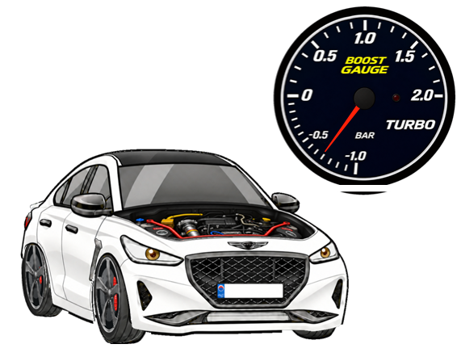
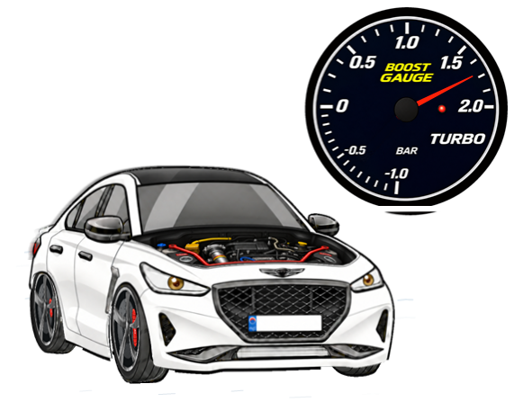
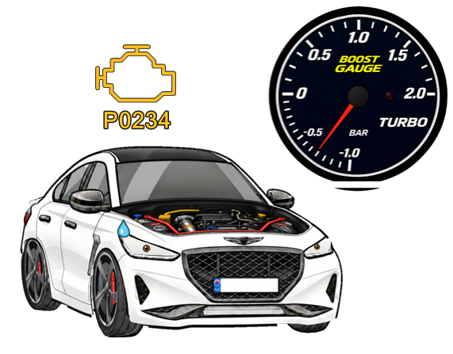

# Genesis G70 mini-pet

타이핑 속도에 맞춰 자동차와 부스트 게이지가 움직이는 Windows 데스크톱 미니펫입니다. 투명 창으로 표시하며, 드래그로 옮기고 우클릭 메뉴에서 크기와 동작을 조절할 수 있습니다.

작성자의 실제 차량을 바탕으로 제작한 미니펫입니다. 기능이나 디자인을 직접 수정하려면 [수정 가이드](source/수정조건.txt)를 참고하세요.

**[Windows 실행용 ZIP 다운로드](https://github.com/leap97/Genesis-G70-mini-pet/releases/latest/download/Genesis-G70-mini-pet-Windows.zip)** · [릴리즈 안내](https://github.com/leap97/Genesis-G70-mini-pet/releases/latest)

압축을 풀고 `G70.exe`를 실행하면 됩니다. 실행 파일과 수정 가능한 소스가 함께 들어 있습니다. 비상업적 이용만 허용하는 비공식 팬 프로젝트이며, 자세한 범위는 [라이선스](LICENSE)와 [권리 고지](NOTICE.md)를 확인하세요.

## 미리보기

프로그램의 렌더러로 만든 상태별 이미지입니다. 바탕화면이나 다른 앱 화면은 포함하지 않습니다.

| 대기 | 주행 |
|:---:|:---:|
|  |  |

| 급감속 | 엔진 경고 연출 |
|:---:|:---:|
|  |  |

### 차량 튜닝 내역

작성자의 실제 차량을 바탕으로 다음 튜닝 요소를 디자인에 반영했습니다.

- 메인텍 인터쿨러
- 타케다 오픈흡기
- 스피디 블로우오프 밸브
- 소울스포츠 스트럿바
- 아이박 다운스프링
- 큐브 오일캐치탱크
- 그외 몰딩과 허브스페이서

## 실행

1. 압축을 쓰기 가능한 폴더에 풀고 `G70.exe`를 실행합니다.
2. 다른 앱에서 타이핑하면 자동차와 부스트가 반응합니다. 한글 입력과 같은 키의 자동 반복도 포함합니다.
3. 자동차나 게이지를 드래그해 이동합니다. 미니펫 또는 알림 영역 아이콘을 우클릭하면 설정·크기·일시정지·종료 메뉴가 열립니다.

Windows와 .NET Framework 4.x가 필요합니다. 별도 런처나 인터넷 연결은 필요하지 않습니다. 기본 그림 크기는 320px이고, 메뉴에서 180~600px로 바꿀 수 있습니다. 투명 여백을 제외한 기본 창 크기는 309×244px입니다.

## 기본 동작

| 타수/분 | 목표 부스트 |
|---|---|
| 150 미만 | 음압~0 bar |
| 150~400 | 0~1.49 bar |
| 400~500 | 1.49~1.50 bar |
| 500~600 | 1.50 bar |
| 600 초과 | 최대 1.70 bar |

압력은 목표값으로 부드럽게 변합니다. 타이핑을 갑자기 멈추면 공회전 음압으로 빠르게 돌아오며, 양압에서 멈춘 경우 `Stututututu`가 1초간 표시됩니다. 다시 입력하면 바로 사라집니다. 게이지 표시값이 1.50 bar 이상이면 빨간 LED가 켜집니다.

엔진 경고의 기본 확률은 0%입니다. 실제 압력이 1.5 bar 이하에서 초과로 올라갈 때마다 추가 확률이 2.5%포인트씩 쌓입니다. 경고가 선택되면 문구 대신 엔진 경고등·`P0234`·당황한 표정이 표시되고, 다음 타이핑까지 유지됩니다.

휠·타이어·디스크는 같은 각도로 회전하고 캘리퍼는 고정됩니다. 대기 중에는 눈을 깜박이고 차체가 들썩입니다. 주행 효과는 뒤쪽 차체와 지붕 윤곽 주변에만 적용하며 얼굴·엔진룸·바퀴·게이지는 선명하게 유지합니다.

## 설정과 개인정보

설정창에서 부스트 구간, 들썩임 강도·속도, 눈 깜박임 속도, 모션블러 강도, 경고 기본 확률을 조절합니다. 첫 실행에는 코드의 기본값을 사용합니다.

- 입력한 문자·문장·클립보드·앱 이름을 기록하지 않습니다. 키 종류를 판별한 뒤 입력 시각만 메모리에서 사용합니다.
- 네트워크 전송, 자동 시작 등록, 백그라운드 서비스를 사용하지 않습니다.
- `source/boost.txt`: 설정을 저장할 때 생성되는 로컬 설정 파일입니다.
- `source/window.txt`: 위치·크기를 저장할 때 생성되는 로컬 설정 파일입니다.

두 설정 파일은 배포본에서 제외했고 `.gitignore`에도 등록했습니다. 관리자 권한 앱이나 Windows 보안 화면에서는 타이핑 반응이 제한될 수 있습니다.

## 소스와 빌드

| 파일 | 용도 |
|---|---|
| `G70.exe` | 바로 실행할 수 있는 프로그램 |
| `source/Desktop.cs` | 창·설정·입력·부스트·렌더링 |
| `source/assets/` | 프로그램에 포함되는 PNG 자산 |
| `source/build-desktop.ps1` | Windows 빌드 스크립트 |
| `source/tests/` | 동작·렌더링 검증 코드와 기준 데이터 |
| [source/수정조건.txt](source/수정조건.txt) | 구조와 수정 시 유지할 기술 조건 |

프로젝트 폴더의 PowerShell에서 실행합니다.

```powershell
.\source\build-desktop.ps1
```

같은 폴더의 `G70.exe`가 실행 중이라면 종료한 뒤 빌드합니다. 다른 폴더에 실행 파일을 만들 수도 있습니다.

```powershell
.\source\build-desktop.ps1 -OutputPath .\source\qa\G70.exe
```

기본 검증은 별도의 테스트 실행 파일로 진행합니다.

```powershell
.\source\build-desktop.ps1 -Test
.\source\qa\G70.Tests.exe --self-test .\source\qa\self-test
```

추가 검증 명령과 자산 규격은 기술 설명 문서를 참고하세요. 테스트 결과와 로컬 설정은 Git 추적 대상에서 제외됩니다.

## 라이선스와 권리 고지

[PolyForm Noncommercial 1.0.0](LICENSE)을 적용합니다. 라이선스가 정한 비상업적 목적의 사용·수정·재배포를 허용하며, 상업적 이용권은 부여하지 않습니다. 재배포할 때 라이선스와 `NOTICE.md`의 `Required Notice:` 고지를 함께 전달하세요. 상업적 이용을 제한하므로 일반적인 오픈소스 라이선스는 아닙니다.

코드와 이미지 제작에 AI를 활용했습니다. 라이선스는 제공자가 보유하거나 허락할 수 있는 권리에만 적용되며, 저작권이 없는 부분에 새로운 권리를 만들지 않습니다. 차량 디자인·상표·로고에 관한 제3자 권리는 포함하지 않습니다. Genesis 또는 현대자동차의 공식 제품이나 제휴·후원 프로젝트가 아닙니다. 자세한 내용은 [NOTICE.md](NOTICE.md)에 정리했습니다.
